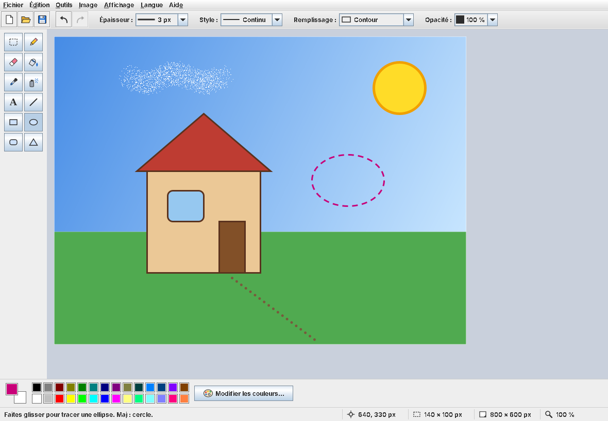

# JPaint : application de dessin (Projet 1, Java II)

Application de dessin inspirée de Paint, écrite en **Java Swing**.
Elle est disponible en **français, anglais et arabe** (interface de droite à gauche).

---

## Lancer l'application

- Double-cliquez sur **`JPaint.jar`**. Il faut Java 8 ou une version plus récente.
- Vous pouvez aussi la lancer en ligne de commande : `java -jar JPaint.jar`
- Pour ouvrir directement une image : `java -jar JPaint.jar photo.png`

Au démarrage, l'application prend la langue de Windows : français, anglais ou arabe (français sinon).
On peut ensuite changer de langue à tout moment avec le menu **Langue**.

## Ouvrir le code dans IntelliJ IDEA

1. Faites **File > Open…** et choisissez le dossier `JPaint`.
2. Si IntelliJ affiche *Project JDK is not defined*, cliquez sur **Setup SDK** et choisissez votre JDK.
3. Lancez la configuration **JPaint** (flèche verte en haut), ou cliquez sur la flèche verte à côté de `main` dans `Main.java`.

---

## Fonctionnalités

- **12 outils** : sélection, crayon, gomme, pot de peinture, pipette, aérographe, texte, ligne, rectangle, ellipse, rectangle arrondi, triangle.
- **Deux couleurs** : couleur 1 au clic gauche, couleur 2 au clic droit. Palette de 28 couleurs (double-clic sur une case pour la modifier) et sélecteur de couleur.
- **Options** : épaisseur, style du trait (continu, tirets, pointillés), remplissage (contour, plein, contour et plein, dégradé), opacité.
- **Touche Maj** : carré, cercle, ligne à 45°.
- **Sélection** : on la déplace à la souris ou aux flèches. On peut la couper, la copier, la coller (avec le presse-papiers du système) ou l'effacer. Le clic droit ouvre un menu contextuel.
- **Annuler / Rétablir** : jusqu'à 30 étapes.
- **Fichiers** : ouvrir et enregistrer en PNG, JPEG, BMP ou GIF. On peut aussi glisser-déposer une image sur la zone de dessin.
- **Menu Image** : changer la taille (agrandir ou étirer), pivoter de 90°, retourner, inverser les couleurs, lisser les formes.
- **Affichage** : zoom de 25 % à 800 % (aussi avec Ctrl + molette), grille, barres masquables.
- **Langues** : français, anglais, arabe. Le changement se fait sans redémarrer.
- **Barre d'état** : aide de l'outil, position de la souris, taille de la forme, taille de l'image, zoom.
- **Avant de quitter, d'ouvrir ou de créer une image**, l'application propose d'enregistrer le dessin.

## Raccourcis clavier

| Raccourci | Action | Raccourci | Action |
|---|---|---|---|
| Ctrl+N | Nouveau | Ctrl+Z / Ctrl+Y | Annuler / Rétablir |
| Ctrl+O | Ouvrir | Ctrl+X / C / V | Couper / Copier / Coller |
| Ctrl+S | Enregistrer | Suppr | Effacer la sélection |
| Ctrl+Maj+S | Enregistrer sous | Ctrl+A | Tout sélectionner |
| Ctrl+E | Taille de l'image | Ctrl+Maj+N | Tout effacer |
| Ctrl+R / Ctrl+Maj+R | Pivoter à droite / à gauche | Ctrl+I | Inverser les couleurs |
| Ctrl+Pg préc. / Pg suiv. | Zoom avant / arrière | Ctrl+0 | Zoom 100 % |
| Ctrl+G | Grille | F1 | À propos |
| Échap | Annuler le tracé en cours / poser la sélection | Flèches (+ Maj) | Déplacer la sélection de 1 px (10 px) |

---

## Organisation du code (`src/paint`)

| Fichier | Rôle |
|---|---|
| `Main.java` | Point d'entrée : apparence du système, langue, ouverture de la fenêtre |
| `PaintFrame.java` | Fenêtre principale (`JFrame`) : menus, barres d'outils, palette, barre d'état, fichiers |
| `DrawingPanel.java` | Zone de dessin (`JPanel`) : souris, outils, aperçu, annuler/rétablir, sélection, zoom, transformations |
| `DrawingListener.java` | Interface d'écoute : la zone de dessin prévient la fenêtre de ses changements |
| `Tool.java`, `StrokeStyle.java`, `FillMode.java` | Énumérations : outils, styles de trait, modes de remplissage |
| `PalettePanel.java` | Palette de couleurs (cases dessinées à la main) |
| `ImageSizeDialog.java`, `TextDialog.java` | Boîtes de dialogue personnalisées (`JDialog`) |
| `ImageSelection.java` | Image placée dans le presse-papiers (`Transferable`) |
| `ImageDropHandler.java` | Glisser-déposer d'un fichier image (`TransferHandler`) |
| `I18n.java` | Internationalisation : textes traduits, changement de langue |
| `Icons.java` | Toutes les icônes, dessinées en Java 2D (aucun fichier image) |
| `OptionRenderer.java`, `CompactPanel.java` | Petits utilitaires d'affichage |
| `i18n/messages*.properties` | Les textes en français (défaut), anglais (`_en`) et arabe (`_ar`) |

## Notions du cours utilisées

| Notion du cours | Où la trouver |
|---|---|
| `JFrame`, contentPane, `JPanel` | `PaintFrame` hérite de `JFrame`, `DrawingPanel` hérite de `JPanel` |
| Layouts : `BorderLayout`, `FlowLayout`, `GridLayout`, `GridBagLayout` | Fenêtre en `BorderLayout`. Boîte à outils et palette en `GridLayout`. Formulaires des dialogues en `GridBagLayout` |
| `JButton`, `JToggleButton`, `JLabel`, `JTextField`, `JCheckBox`, `JRadioButton` + `ButtonGroup`, `JComboBox` | Barres d'outils, `ImageSizeDialog`, `TextDialog` |
| Menus : `JMenuBar`, `JMenu`, `JMenuItem`, `JCheckBoxMenuItem`, `JRadioButtonMenuItem`, mnémoniques, raccourcis, `JPopupMenu` | `PaintFrame.createMenuBar()`, `createSelectionMenu()` |
| `JToolBar`, `JScrollPane` | `PaintFrame.createOptionsBar()`, `createToolsBar()`, `createCanvasArea()` |
| `JOptionPane` (message, confirmation, options), `JDialog` personnalisé, `JColorChooser`, `JFileChooser` | `PaintFrame` (enregistrer, à propos, erreurs), `ImageSizeDialog`, `TextDialog`, `PalettePanel` |
| Événements : `ActionListener` (lambdas), `ItemListener`, `MouseAdapter`, `MouseMotionListener`, `MouseWheelListener`, `KeyAdapter`, `WindowAdapter` | `DrawingPanel.MouseHandler` et `KeyHandler` (classes internes), `PaintFrame` |
| Modèle de délégation (source / écouteur) | `DrawingListener` : `DrawingPanel` est la source, `PaintFrame` l'écouteur |
| Dessin 2D : `paintComponent`, `repaint`, `Graphics2D` | `DrawingPanel.paintComponent()` |
| Formes `java.awt.geom` : `Line2D`, `Rectangle2D`, `Ellipse2D`, `RoundRectangle2D`, `GeneralPath`, `Area` | `DrawingPanel.createShape()`, `Icons` |
| `BasicStroke`, `GradientPaint`, `AlphaComposite`, `RenderingHints`, `AffineTransform`, découpage (clip) | `StrokeStyle`, `DrawingPanel.paintShape()`, `rotate()`, `flip()`, `Icons` |
| Images : `BufferedImage`, `ImageIO.read` / `write`, `drawImage` | `DrawingPanel`, `PaintFrame.openFile()`, `writeFile()` |
| Transfert de données : glisser-déposer (`TransferHandler`), copier-coller (`Transferable`, `DataFlavor`, presse-papiers) | `ImageDropHandler`, `ImageSelection`, `DrawingPanel.copy()` et `paste()` |
| Internationalisation : `Locale`, `ResourceBundle`, `.properties`, `MessageFormat`, `DateFormat`, sens d'écriture | `I18n`, `i18n/*.properties`, `PaintFrame.about()` |

---

## Recompiler le JAR

- **Windows** : double-cliquez sur `build.bat`.
- **Linux / macOS** : lancez `./build.sh`.

Il faut un JDK installé, avec les commandes `javac` et `jar` dans le PATH.

| | |
|---|---|
| **Réalisé par** | HALOUBI Ahmed, EL KIHEL Riyad |
| **Encadré par** | M. Mustapha OUJAOURA |
| **Module** | Java II (Programmation Java Avancée) – ENSA Safi |
| **Année** | 2026-2027 |
| **Exécutable** | [Télécharger JPaint.jar](../../releases/latest) (Java 8 ou plus récent) |../releases/latest)** (Java 8 ou plus récent)